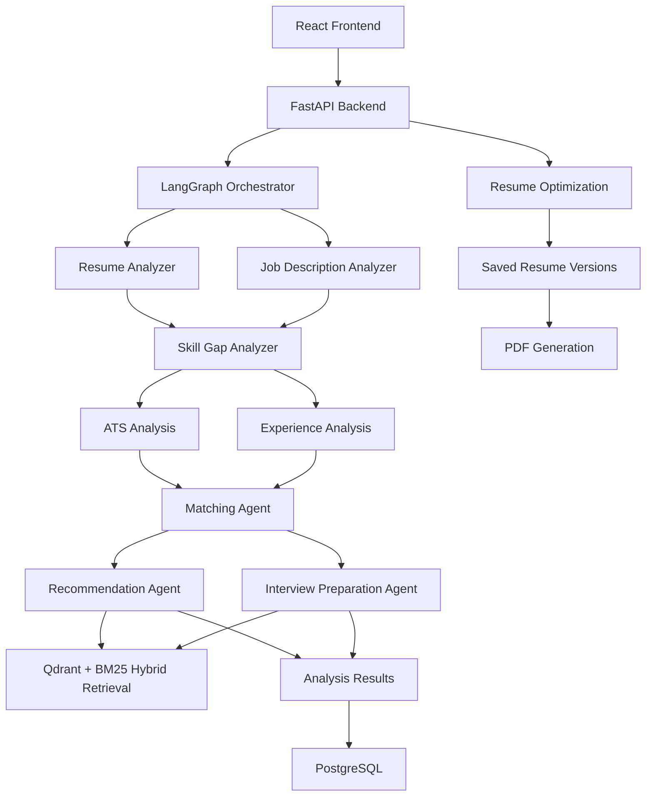

# Multi-Agent Job & Resume Intelligence System

An AI-powered career intelligence platform that analyzes resumes against job descriptions, identifies skill gaps, evaluates job compatibility, generates personalized recommendations, and creates tailored resumes using a multi-agent AI workflow.

**Live Demo:** https://multi-agent-carrer-ai.vercel.app  
**Backend API:** https://multi-agent-carrer-ai.onrender.com  
**API Documentation:** https://multi-agent-carrer-ai.onrender.com/docs

---

## Overview

Multi-Agent Career AI is a full-stack Generative AI application built using specialized AI agents coordinated through LangGraph.

Instead of relying on a single LLM prompt, the application distributes resume and job-description analysis across specialized agents. Their outputs are combined to produce an explainable career analysis and actionable recommendations.

The platform also supports user-triggered resume optimization, saved tailored resume versions, and PDF generation.

## Key Features

- **Resume Analysis:** Upload and extract information from resumes.
- **Job Description Analysis:** Extract job titles, required skills, experience, and qualifications.
- **Multi-Agent Orchestration:** Coordinate specialized AI agents using LangGraph.
- **Skill Gap Analysis:** Identify matching and missing technical skills.
- **ATS Compatibility Analysis:** Estimate ATS compatibility using job-related keyword analysis.
- **Experience Analysis:** Evaluate the relevance of projects and professional experience.
- **Job Match Scoring:** Calculate a weighted match score using deterministic scoring logic.
- **AI Recommendations:** Generate personalized recommendations grounded in retrieved reference material.
- **Interview Preparation:** Generate role-relevant interview questions.
- **Resume Tailoring:** Optimize resume content for a selected job description.
- **Saved Resume Versions:** Save and manage multiple tailored resume versions.
- **PDF Export:** Download generated tailored resumes as PDF files.

## System Architecture

The application follows a multi-agent architecture with parallel execution and retrieval-augmented generation.



### Multi-Agent Workflow

The analysis pipeline contains eight specialized graph nodes:

1. **Resume Analyzer:** Extracts structured information from the candidate's resume.
2. **Job Description Analyzer:** Extracts job requirements and relevant skills.
3. **Skill Gap Analyzer:** Compares candidate skills against job requirements.
4. **ATS Analysis Agent:** Estimates ATS compatibility.
5. **Experience Analysis Agent:** Evaluates experience and project relevance.
6. **Matching Agent:** Calculates an overall job compatibility score and generates its explanation.
7. **Recommendation Agent:** Generates personalized career improvement recommendations.
8. **Interview Preparation Agent:** Generates relevant interview preparation questions.

The workflow uses parallel execution for independent analysis tasks to improve efficiency.

## Retrieval-Augmented Generation (RAG)

The recommendation and interview preparation agents use a curated knowledge base to ground their outputs.

The retrieval pipeline includes:

- Gemini embeddings
- Qdrant vector search
- BM25 keyword retrieval
- Reciprocal Rank Fusion (RRF)

This combines semantic and keyword-based retrieval to provide relevant context to the agents.

## Technology Stack

| Category | Technologies |
|---|---|
| Backend | Python, FastAPI |
| Frontend | React, TypeScript, Tailwind CSS, Vite |
| AI Orchestration | LangGraph |
| LLM | Google Gemini |
| Embeddings | Gemini Embeddings |
| Vector Database | Qdrant |
| Retrieval | BM25, Hybrid Search, RRF |
| Database | PostgreSQL |
| ORM | SQLAlchemy |
| Migrations | Alembic |
| Document Processing | PyMuPDF, python-docx, Tesseract OCR |
| PDF Generation | ReportLab |
| Deployment | Render, Vercel |
| Containerization | Docker, Docker Compose |

## Project Structure

```text
multi-agent-career-ai/
│
├── backend/
│   ├── app/
│   │   ├── agents/
│   │   ├── api/
│   │   │   └── routes/
│   │   ├── core/
│   │   ├── db/
│   │   ├── models/
│   │   ├── rag/
│   │   ├── schemas/
│   │   └── services/
│   ├── tests/
│   ├── migrations/
│   └── requirements.txt
│
├── frontend/
│   └── src/
│
├── data/
│   └── knowledge_base/
│
├── docs/
├── evaluation/
├── docker/
├── Dockerfile
├── docker-compose.yml
├── .env.example
└── README.md
```

## Deployment Architecture

The application is deployed using separate cloud services:

| Component | Deployment Platform |
|---|---|
| React Frontend | Vercel |
| FastAPI Backend | Render |
| PostgreSQL Database | Render PostgreSQL |
| Vector Database | Qdrant Cloud |
| LLM Provider | Google Gemini |

**Live Application:**  
https://multi-agent-carrer-ai.vercel.app

**Backend API Documentation:**  
https://multi-agent-carrer-ai.onrender.com/docs

## Local Development

### Prerequisites

- Python 3.12
- Node.js and npm
- Docker Desktop
- Google Gemini API key
- Qdrant instance

### 1. Clone the repository

```bash
git clone https://github.com/Ujjawal-22/multi-agent-carrer-AI.git

cd multi-agent-carrer-AI
```

### 2. Configure environment variables

Copy the example environment file:

```bash
copy .env.example .env
```

Configure the required database, Gemini, and Qdrant settings in `.env`.

Never commit your actual `.env` file or API credentials.

### 3. Start backend infrastructure

```bash
docker compose up -d postgres qdrant
```

### 4. Start the backend

```bash
cd backend

python -m venv my_env
```

Activate the environment on Windows:

```powershell
.\my_env\Scripts\Activate.ps1
```

Install dependencies:

```bash
pip install -r requirements.txt
```

Start FastAPI:

```bash
uvicorn app.main:app --reload
```

Backend documentation:

http://localhost:8000/docs

### 5. Start the frontend

Open another terminal:

```bash
cd frontend

npm install

npm run dev
```

Open the local frontend URL printed by Vite in your terminal.

For the complete setup and phase-specific documentation, refer to the files inside the `docs/` directory.

## Engineering Decisions

Some important architectural decisions include:

- **LangGraph orchestration:** Separates responsibilities across specialized agents and supports parallel execution.
- **Deterministic matching score:** Calculates the numerical match score using weighted logic rather than asking an LLM to invent a score.
- **LLM provider abstraction:** Keeps agent logic separate from the underlying model provider.
- **Hybrid retrieval:** Combines semantic and keyword search for knowledge retrieval.
- **Structured LLM outputs:** Uses defined schemas to keep agent responses consistent.
- **PostgreSQL persistence:** Stores analysis results and saved resume versions.
- **Docker-based deployment:** Provides a reproducible backend deployment environment.

## Current Limitations

- ATS compatibility is an AI-based heuristic estimate, not a guarantee of passing an actual ATS.
- Hybrid retrieval currently uses dense and BM25 search without a cross-encoder reranking stage.
- Some matching sub-scores, including education and domain relevance, use relatively simple keyword-overlap heuristics.
- Retrieval source-attribution metadata is not yet persisted for every analysis response.
- The curated knowledge base has limited role coverage.

## Future Improvements

- Expand the curated knowledge base across more job roles and industries.
- Introduce retrieval evaluation and optional reranking.
- Improve matching quality through benchmark datasets and measured evaluation.
- Expand test coverage and production monitoring.
- Improve resume formatting and tailoring controls.

## Author

**Ujjawal Srivastava**

B.Tech – Computer Science & Engineering

**Interests:** Generative AI, Agentic AI, Machine Learning, Computer Vision, and Multi-Agent Systems.

- GitHub: https://github.com/Ujjawal-22
- LinkedIn: https://www.linkedin.com/in/ujjawal-srivastava22

---

*Built as a practical Generative AI engineering project demonstrating multi-agent orchestration, RAG, structured LLM outputs, full-stack development, and cloud deployment.*
